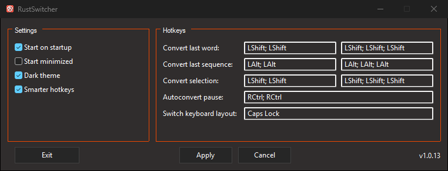

# Rust Switcher



Rust Switcher is a Windows 11 utility that helps convert text between RU and EN keyboard layouts.

## Features

- Convert selected text (RU↔EN)
- Convert the last typed sequence via a hotkey ("smart" conversion also handles selection)
- Auto-convert the last word while typing (can be disabled in Settings; runtime toggle starts paused)
- Tray icon and quick actions menu
- Light and dark UI themes
- Settings are saved to a config file
- Autostart

## Requirements

- Windows 11
- Rust nightly (see `rust-toolchain.toml`)
- MSVC toolchain (Visual Studio 2022 Build Tools)

## Install

### Via cargo

```powershell
cargo install rust-switcher
```

### From GitHub Releases

Download `rust-switcher.exe` from Releases.

## Configuration

The config file is stored at:

* `%APPDATA%\RustSwitcher\config.json`

Default hotkey sequences:

* Convert last word: double tap Left Shift
* Convert last sequence: double tap Left Alt
* Convert selection: double tap Left Shift
* Autoconvert toggle: double tap Right Ctrl
* Switch layout: CapsLock

To remove a binding, focus its hotkey field and press Backspace or Delete.

## Development

Security and privacy properties are documented in [`docs/security.md`](docs/security.md). Windows
acceptance checks are listed in
[`docs/windows-11-manual-test-plan.md`](docs/windows-11-manual-test-plan.md).

To build a local release from the reviewed source tree and print its SHA-256, run from the
repository root:

```powershell
.\scripts\build-release.ps1
```

Do not treat an upstream release executable as the production binary for a reviewed fork.

This project includes a ready-to-use `bacon.toml` for a fast development loop.

### Bacon hotkeys (from `bacon.toml`)

* `d` dev-long
* `r` release-long
* `t` test-long
* `p` dushnota

What these jobs do:

* dev-long: fmt check, clippy, build (with debug tracing), run the app
* release-long: fmt check, clippy, release build, run the app
* test-long: fmt check, clippy, run tests
* dushnota: strict clippy

## Logging (development only)

```powershell
$env:RUST_LOG="trace"
cargo +nightly run -F debug-tracing
```

## License

MIT

## Локальные результаты и графы

Сгенерированные графы `graphify-out/`, отчёты, captures и результаты прогонов
хранятся локально в игнорируемых каталогах. Не добавляйте их в Git, включая
`git add -f`. Исходники, необходимые тестовые данные и эталоны остаются в Git.
После нового клонирования создайте граф штатной командой проекта перед его
использованием; наличие сохранённого графа в истории Git не требуется.
