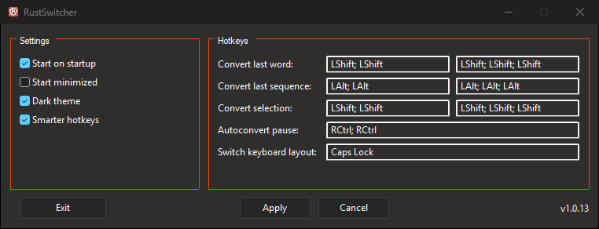

# Rust Switcher



Rust Switcher is a Windows 11 utility that converts text between your installed keyboard layouts.

It was created as an open-source alternative to Punto Switcher and Caramba
Switcher with a clear privacy requirement: keyboard input stays on your device.
**No telemetry, no usage analytics, and no input uploads.** Text conversion and
language scoring happen on your computer. English and Russian models are bundled;
other languages can use existing verified local models. This fork has no runtime
network access or self-updater.

## Features

- Convert selected text using keyboard layouts configured in Windows
- Convert the last typed sequence via a hotkey ("smart" conversion also handles selection)
- Auto-convert the last word while typing (can be disabled in Settings; runtime toggle starts paused)
- Automatically discover added and removed Windows layouts, including variants of the same language
- Read verified local language models on demand, without downloads
- Tray icon and quick actions menu
- Light and dark UI themes
- Settings are saved to a config file
- Autostart

## Requirements

- Windows 11
- Rust nightly (see `rust-toolchain.toml`)
- MSVC toolchain (Visual Studio 2022 Build Tools)

## Install

### Build this fork locally

```powershell
cargo +nightly build --release --locked
```

Use the resulting `target\release\rust-switcher.exe`. An upstream release or
`cargo install rust-switcher` installs upstream behavior rather than this fork's
security changes.

### Updating

Updates are manual: review source changes, build this fork, exit Rust Switcher,
and replace its executable. The application does not check for or install updates.

## Configuration

The config file is stored at:

* `%APPDATA%\RustSwitcher\config.json`

Default hotkey sequences:

* Convert last word: double tap Left Shift
* Convert last sequence: double tap Left Alt
* Convert selection: double tap Left Shift
* Autoconvert toggle: double tap Right Ctrl
* Switch layout: CapsLock

To remove a binding, focus its hotkey field and press Backspace or Delete.

## Keyboard languages

Add or remove keyboard layouts in Windows. Rust Switcher uses that list directly;
there is no separate language list to maintain in the application. Changes are
picked up when the next conversion is requested, without restarting Rust Switcher.

Conversions use the physical key positions and the corresponding Windows layout
drivers. This preserves distinctions such as QWERTY, QWERTZ, AZERTY, and variants
sharing a language. Shift, Caps Lock, AltGr, and ordinary dead-key combinations
use the character and accent tables supplied by the installed keyboard driver.
Composition is tracked inside Rust Switcher. Legacy IME registrations and
unsupported keyboard-table formats are rejected; a transformation that cannot
be completed is left unchanged. Modern TSF composition and custom text services
are unsupported: a foreground keyboard-layout handle alone does not reliably
identify their composition state.
Custom keyboard drivers need a locally verifiable embedded or Windows catalog
signature to be loaded.

With several layouts installed, local character n-gram models rank possible
results. The model catalog covers 75 languages; only models relevant to installed
layouts are requested. English and Russian work immediately offline. Additional
models are read in the background from existing local files under
`%LOCALAPPDATA%\RustSwitcher\models\<model-hash>\<language>.fst`.
Their expected size and SHA-256 are verified before use. Missing or invalid models
are unavailable; no files are downloaded or written to the model cache.

An explicit conversion has a deterministic fallback to the next usable Windows
layout when language evidence is ambiguous or unavailable, including punctuation.
Smart conversion and AutoConvert leave text unchanged when evidence is insufficient.
Unavailable models do not block keyboard input; existing valid models remain usable.

The recent-input journal holds up to 4,096 characters. A conversion that would
include a prefix already dropped from the journal is rejected as a whole. Selecting
text uses a separate path with a 512-character, single-line limit.

## Privacy

**Your input stays on your device.** Rust Switcher processes keyboard input
and selected text locally and does not collect telemetry or usage analytics.
It does not upload typed text, selections, input history, or preferences to
the developer or third parties.

Recent input is held temporarily in memory to support conversion; preferences
are saved locally. Confirmed password fields clear the journal and its cache,
and block journaling and text conversion. The [privacy policy](PRIVACY.md) explains
detection limits, retention, clipboard behavior, and metadata-only development logging.

Pausing or disabling AutoConvert leaves keyboard tracking and manual hotkeys
running. To stop all processing, right-click the tray icon and choose **Exit**;
closing the settings window only hides it.

## Development

This project includes a ready-to-use `bacon.toml` for a fast development loop.

### Bacon hotkeys (from `bacon.toml`)

* `d` dev-long
* `r` release-long
* `t` test-long
* `p` dushnota

What these jobs do:

* dev-long: fmt check, clippy, build (with debug tracing), run the app
* release-long: fmt check, clippy, release build, run the app
* test-long: fmt check, clippy, run tests
* dushnota: strict clippy

## Logging (development only)

```powershell
$env:RUST_LOG="trace"
cargo +nightly run -F debug-tracing
```

## License

MIT

## Локальные результаты и графы

Сгенерированные графы `graphify-out/`, отчёты, captures и результаты прогонов
хранятся локально в игнорируемых каталогах. Не добавляйте их в Git, включая
`git add -f`. Исходники, необходимые тестовые данные и эталоны остаются в Git.
После нового клонирования создайте граф штатной командой проекта перед его
использованием; наличие сохранённого графа в истории Git не требуется.
